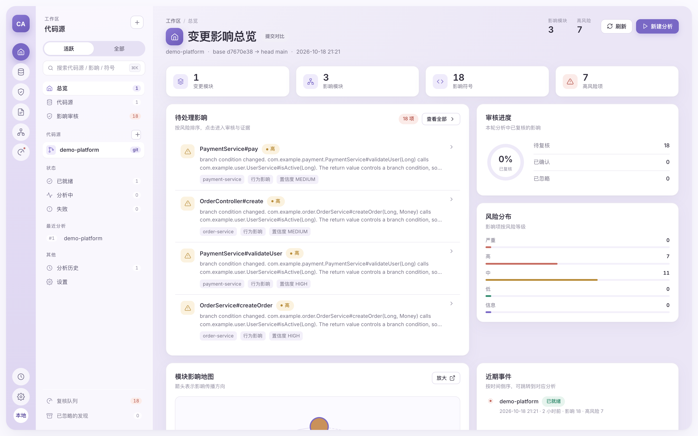
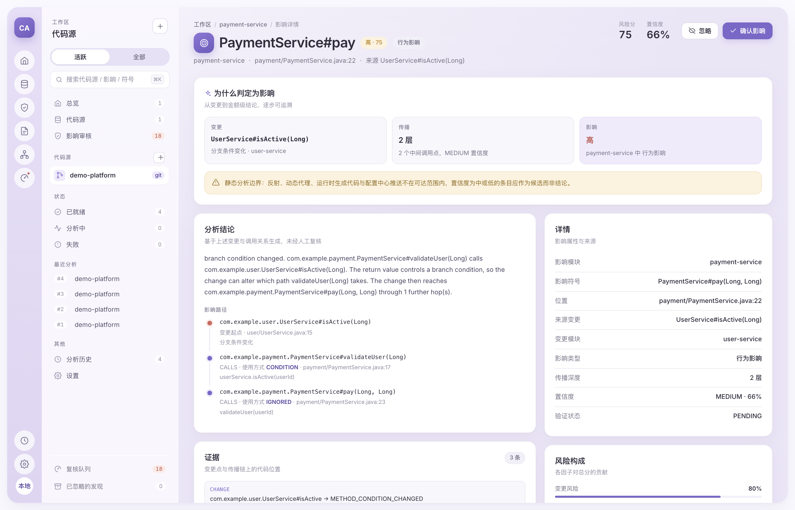
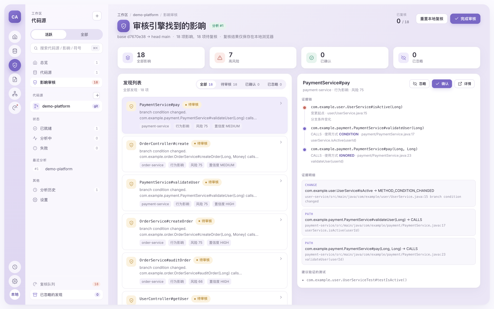
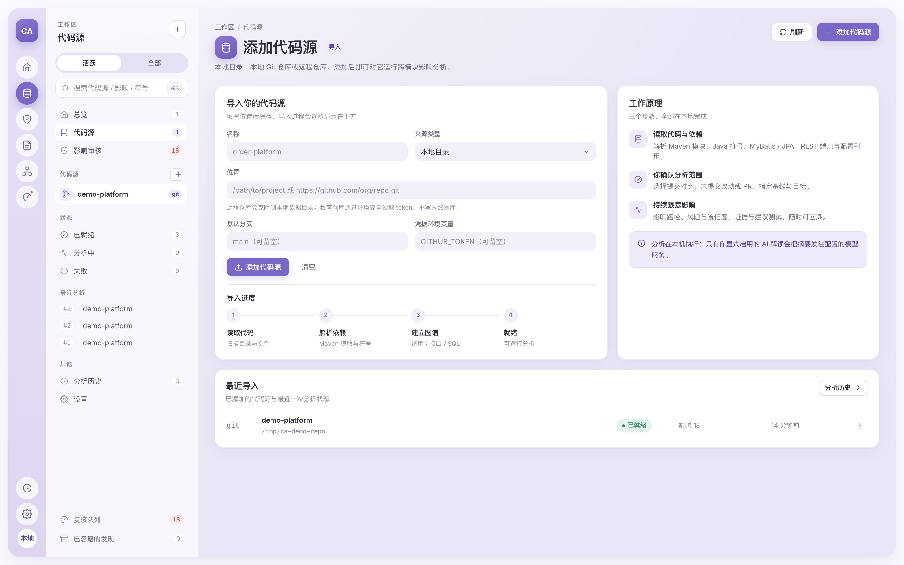
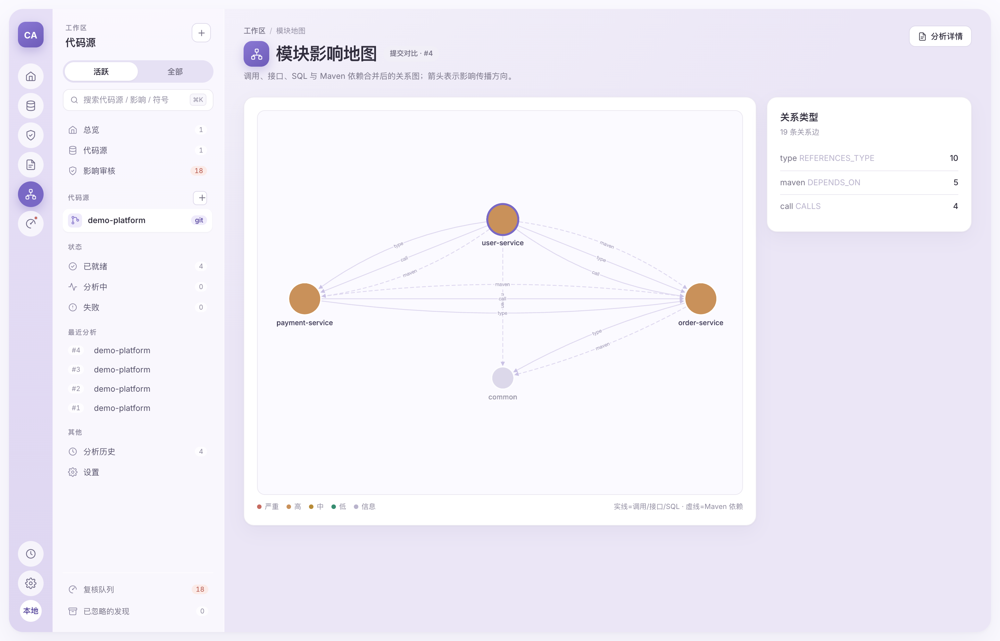

# code-association · 其他程序变更影响扫描

给定一次代码变更（本地未提交改动 / 两次提交 / 分支 / PR·MR），分析它对**其他程序模块**的影响，
并给出：影响路径、影响原因、代码位置、影响类型、风险等级、分析置信度、建议验证的测试。

> 扫描范围只有“其他程序”。本程序内部的调用方、模块、测试覆盖和传播链不会进入影响结果。
> 因此每次分析至少需要选择一个被扫描的其他程序。

支持的程序来源：本地目录、本地 Git 仓库、GitHub、GitLab、任意 Git 远程仓库。
分析对象以 **Java + Maven 多模块项目**为主，同时解析 MyBatis / JPA / Spring MVC / 配置文件，
以及 Kafka / RabbitMQ / RocketMQ 的消息契约，因此同一仓库内的模块、通过 HTTP、数据库、
配置或消息主题相连的服务都能被串起来。



> 一次真实运行的界面：`user-service` 的 `isActive` 判定条件被改动，报告指出 `order-service`、
> `payment-service` 受影响，并给出每条的路径、原因、风险与置信度。
>
> 界面采用两级导航（图标栏 + 文字导航）与任务优先的不等宽卡片布局，
> 包含总览、代码源导入、影响审核、影响详情、复核队列、模块地图六个工作区。

---

## 1. 它到底做了什么

```text
代码来源（本地 / Git / GitHub / GitLab）
        │
        ▼  ① 变更解析：Git diff → AST 语义差异（不是文本比较）
        │     方法签名 / 实现 / 分支条件 / 字段类型 / 枚举 / 接口契约 / SQL / DDL / 配置
        ▼
        ② 代码知识图谱：模块依赖 · 方法调用 · 类型继承 · 接口实现 · 数据流用法
        │     · REST 端点与消费方 · MyBatis/JPA 表与列 · 配置项引用
        │     · Kafka/RabbitMQ/RocketMQ 主题、路由、消息 Schema · 测试关联
        ▼
        ③ 影响分析引擎：反向可达性传播 + 用法语义过滤 + 接口/数据/配置专项传播
        ▼
        ④ 风险与置信度：两个独立维度，可解释的风险因子分解
        ▼
        ⑤ 结果展示：跨程序契约地图 · 其他程序影响明细 · 变更清单 · 路径与证据 · 代码差异
```

跨程序传播时同样区分使用方式。对方程序里的调用方如何使用被调用方法的返回值，
（`CONDITION` 参与分支 / `ASSIGNMENT` 赋值后继续传递 / `ARGUMENT` 作为实参 / `RETURN` 继续返回 /
`LOG_ONLY` 仅打日志 / `IGNORED` 被忽略），并据此降低或提高行为影响的权重：

```java
// 返回值控制分支 → 行为影响权重 1.0
boolean active = userService.isActive(userId);
if (!active) { throw new IllegalStateException("user is not active"); }

// 返回值只进日志 → 行为影响权重 0.2
boolean active = userService.isActive(userId);
log.info("audit active={}", active);
```

同一个 `UserService.isActive` 的变更，前者被评为 HIGH，后者显著更低——这正是减少误报的关键。

---

## 2. 快速开始

```bash
# 需要 JDK 21+
mvn -q -DskipTests package

./start.sh          # 后台启动，默认 http://127.0.0.1:9996
./start.sh 8080     # 指定端口
./stop.sh           # 停止
```

`start.sh` 用 `nohup` 把进程从当前 shell 脱离（PPID=1），关闭终端不会带走服务；
日志写到 `code-association.log`，PID 写到 `.code-association.pid`。也可以前台直接运行：

```bash
java -jar target/code-association.jar --server.port=9996
```

界面里：右上角「新建分析」→ 选择代码源与分析模式 → 开始分析。首次使用先在「代码源」页导入项目。

### 2.1 三种分析模式

| 模式 | 含义 | 典型场景 |
|---|---|---|
| `GIT_DIFF` | 比较两个提交 / 分支 / tag | 合并前评估、分支对比 |
| `WORKTREE_DIFF` | 工作区（含未提交改动）对比 HEAD | 提交前自查"我这次改动会影响谁" |
| `PULL_REQUEST` | 拉取 PR / MR 的 head，与目标分支的 merge-base 比较 | CI 中拦截高风险变更 |

不填基线时，`GIT_DIFF` 自动取目标提交的父提交（即"最近一次提交改了什么"）。

### 2.2 来源类型

| 类型 | 位置写法 | 说明 |
|---|---|---|
| `LOCAL_DIR` | `/path/to/project` | 直接读取本地目录（工作区即目标版本） |
| `LOCAL_GIT` | `/path/to/repo` | 本地 Git 仓库，可做提交对比 / 未提交对比 / PR |
| `GITHUB` | `https://github.com/org/repo.git` | 克隆到本地数据目录，PR ref 为 `refs/pull/N/head` |
| `GITLAB` | `https://gitlab.com/group/repo.git` | MR ref 为 `refs/merge-requests/N/head` |

界面的「来源类型」只提供上述四种。通用 Git 远程地址（如自建 Git 服务、Bitbucket）没有对应的
下拉项，需要时用命令行 `--type GIT` 或直接调用 API 创建，能力与远程仓库一致，
可用 `--base/--target` 指定分支。

私有仓库：在「凭据环境变量」里填变量名（如 `GITHUB_TOKEN`），服务从**环境变量**读取 token，
不落库、不写入报告。GitHub 用 `oauth2:<token>`，GitLab 可用 `oauth2:<token>` 或私有 token。

---

## 3. 命令行 / CI 集成

`--peer` 是必填的：扫描范围只有其他程序，没有对比对象就没有可报告的内容。

```bash
# 分析最近一次提交对其他程序的影响，把高风险当作失败（可用于流水线门禁）
java -jar code-association.jar analyze \
     --location /path/to/repo --base HEAD~1 --target HEAD \
     --peer /path/to/order-service --peer https://github.com/org/billing.git \
     --out impact-report.json --fail-on HIGH

# 本地未提交改动
java -jar code-association.jar analyze --location . --mode WORKTREE_DIFF \
     --peer /path/to/other-service --out report.json

# GitHub PR（第 42 号）
java -jar code-association.jar analyze --location https://github.com/org/repo.git \
     --type GITHUB --pr 42 --peer /path/to/consumer --out report.json --fail-on HIGH
```

退出码：`0` 通过，`1` 命中 `--fail-on` 阈值，`2` 参数或仓库解析失败（含缺少 `--peer`）。
`analyze` 子命令不会启动 Web 服务。

### 3.1 直接生成 PR 评论

```bash
java -jar code-association.jar analyze --location . --base origin/main --target HEAD \
     --format markdown --out impact.md
```

`--format markdown` 输出一段可直接贴到 GitHub PR / GitLab MR 的评论：结论、其他程序影响表、
逐条影响（位置 / 原因 / 影响路径 / 建议验证的测试）以及分析边界。例如：

```text
## 跨模块变更影响分析
**结论：** 存在高风险跨模块影响，建议人工评审后再合并

| 模块 | 风险 | 影响符号 | 最深层级 | 影响类型 |
| order-service | HIGH 75 | 6 | 5 | 行为 / 数据 |

1. HIGH 75 · 行为 · 置信度 HIGH
   - 位置：order-service OrderService#createOrder(Long, Money) — .../OrderService.java:18
   - 原因：branch condition changed. OrderService#createOrder(Long, Money) calls
           UserService#isActive(Long). The return value controls a branch condition ...
   - 影响路径：UserService#isActive(Long) -> OrderService#createOrder [CONDITION] -> OrderController#create [IGNORED]
   - 建议验证：UserServiceTest#testIsActive()
```

### 3.2 全部命令行参数

| 参数 | 说明 |
|---|---|
| `--location` | 本地路径或 Git 地址（必填） |
| `--peer` | 被扫描的其他程序，可重复（必填，至少一个） |
| `--type` | `LOCAL_DIR` / `LOCAL_GIT` / `GITHUB` / `GITLAB` / `GIT`，省略时按地址推断 |
| `--mode` | `GIT_DIFF`（默认）/ `WORKTREE_DIFF` / `PULL_REQUEST` |
| `--base` `--target` | 基线 / 目标引用，`--base` 省略时取目标提交的父提交 |
| `--pr` | PR / MR 编号（自动切换为 `PULL_REQUEST`） |
| `--token-env` | 存放访问令牌的环境变量名 |
| `--out` `--format` | 输出文件与格式（`json` / `markdown`） |
| `--fail-on` | `CRITICAL` / `HIGH` / `MEDIUM` / `LOW`，命中阈值时退出码为 1 |

GitLab CI 示例：

```yaml
impact:
  image: eclipse-temurin:21-jre
  script:
    - java -jar code-association.jar analyze
        --location "$CI_PROJECT_DIR" --base "$CI_MERGE_REQUEST_TARGET_BRANCH_NAME"
        --target "$CI_COMMIT_SHA" --peer "$PEER_DIR" --out impact.json --fail-on HIGH
  artifacts:
    paths: [impact.json]
    when: always
```

---

## 4. 分析引擎是怎么工作的

### 4.1 变更识别（语义，而非文本）

文本 diff 只能告诉你"这一行变了"，引擎要回答"什么变了、属于哪类变化"。
每个变更都带稳定的符号标识：`模块::全限定名#方法名(参数类型)`。

| 变更类型 | 判定依据 | 主要传播方式 |
|---|---|---|
| `METHOD_SIGNATURE_CHANGED` | 参数或返回类型哈希变化 | 编译影响 + 调用方 |
| `METHOD_CONDITION_CHANGED` | 分支/返回条件指纹变化 | 行为影响（控制依赖） |
| `METHOD_BODY_CHANGED` | 方法体哈希变化 | 行为影响（较弱） |
| `METHOD_REMOVED` / `FIELD_REMOVED` | 符号在 head 缺失 | 编译影响 |
| `FIELD_TYPE_CHANGED` | 字段类型变化 | 类型 / 序列化影响 |
| `ENUM_CONSTANT_REMOVED` | 枚举常量缺失 | 编译 + 契约 |
| `API_CONTRACT_CHANGED` | 同一端点响应类型变化 | 接口契约 → 消费方 |
| `SQL_CHANGED` / `DDL_CHANGED` | SQL 体或 DDL 语句变化 | 数据影响 → Mapper/Entity |
| `CONFIG_CHANGED` | 配置键值变化 | 配置影响 → 读取方 |
| `TOPIC_REMOVED` / `TOPIC_ADDED` | 消息主题缺失 / 新增 | 消息契约 → 生产者、消费者 |
| `MESSAGE_ROUTE_CHANGED` | Topic、Exchange、Queue、Routing Key 或 Tag 变化 | 投递路径 → 两端代码 |
| `MESSAGE_REQUIRED_CHANGED` / `MESSAGE_FIELD_*` | 消息 DTO 必填性、字段、类型变化 | 消息契约 → 生产与消费端 |
| `MESSAGE_SCHEMA_CHANGED` | JSON / Avro / Protobuf 等消息 Schema 变化 | 消息契约 → 两端代码 |
| `BUILD_CHANGED` | pom.xml 变化 | 依赖 / 版本影响 |

### 4.2 知识图谱的七类关系

```text
DEPENDS_ON      模块 → 模块（pom.xml，真实构建模型）
CALLS           方法 → 方法（含接口/抽象方法的分派边）
INSTANTIATES    方法 → 构造器
REFERENCES_TYPE 类型 → 类型（字段/参数/返回/局部变量）
EXTENDS / IMPLEMENTS / OVERRIDES   类型层次
EXPOSES_API / CALLS_API            端点提供方 / 消费方（Spring MVC、Feign、RestTemplate、OpenAPI）
EXECUTES_SQL / READS_TABLE / WRITES_TABLE / READS_COLUMN / WRITES_COLUMN / MAPS_COLUMN
USES_CONFIG     代码 → 配置项（@Value、@ConfigurationProperties、@ConditionalOnProperty）
PUBLISHES_TO / SUBSCRIBES_TO  生产者/消费者 → 消息投递通道
ROUTES_TO       Topic / Exchange → 实际投递通道
USES_MESSAGE_SCHEMA  代码 → 消息体契约
FILTERS_BY      消费者 → RocketMQ Tag / RabbitMQ Routing Key
TESTS           测试用例 → 被测符号
```

每条边都记录 `confidence` 与 `evidence`（静态解析 / 方法引用 / 分派 / 配置推导），
无法解析的调用会进入**盲区清单**，而不是被悄悄忽略。

### 4.3 传播算法

```text
I₁ = 直接调用方/引用方（反向边，一次跳转）
Iₙ₊₁ = Iₙ ∪ Pred(Iₙ)     直到深度上限或置信度衰减到阈值以下
```

实现要点：

- 在 **base 与 head 合并后的图**上反向遍历：被删除的符号只存在于 base 图，其调用方只存在于 head 图。
- 每个节点保留"最短且置信度最高"的那条路径（避免路径爆炸）。
- 传播权重 = 边置信度 × 关系系数 × 用法系数；`TESTS` 边不参与传播（测试是验证手段，不是被影响方）。
- 首跳决定影响类型（`COMPILE` / `BEHAVIOR` / `API_CONTRACT` / `DATA` / `CONFIG` / `TYPE`）。
- 消息变更使用 `MESSAGE_CONTRACT`；从消息入口方法继续沿其下游调用展开，避免只找到消费者本身。

### 4.4 风险与置信度分离

```text
R = 100 × (0.25·S + 0.20·D + 0.20·B + 0.20·C + 0.15·U)

S 变更本身的风险      D 传播深度衰减      B 行为变化可能性（含用法权重）
C 影响对象重要程度    U 分析不确定性（= 1 - 置信度）
```

等级：`CRITICAL ≥80`、`HIGH ≥60`、`MEDIUM ≥40`、`LOW ≥20`、`INFO <20`。

**风险高但置信度低**是完全正常且必须展示的组合：影响可能很严重，但静态分析没把握，
此时结论是"需要人工确认"，而不是"确定受影响"。报告中两个数字分开显示，并在详情面板给出风险因子分解。

---

## 5. 界面

左侧是两级导航：窄图标栏切换主功能区，文字导航承载代码源、状态分组、计数与最近分析。
右侧工作区按任务优先级分配宽度，主任务占更大面积，辅助信息放右侧。

| 工作区 | 内容 |
|---|---|
| **总览** | 待处理影响、审核进度环、风险分布、模块影响地图、近期事件时间线与最近分析 |
| **代码源** | 导入表单、四步导入进度、工作原理说明、最近导入记录 |
| **影响审核** | 发现列表（待审核 / 已确认 / 已忽略），右侧证据链与逐跳路径，确认 / 忽略操作 |
| **影响详情** | 变更 → 传播 → 影响三段式结论、影响路径、证据、风险因子分解、建议验证的测试、代码差异 |
| **复核队列** | 高风险待复核、复核建议、处理进度 |
| **模块地图** | 放大版依赖图与关系类型统计 |

选中代码源与加载报告是两件事：点击左侧代码源即把工作区切换到它，即使该源还没有任何分析。
此时各页显示「这个代码源还没有分析记录」并引导新建分析，而不是保留上一个代码源的结果。

- **模块影响地图**：Cytoscape 依赖图，节点大小=风险分，颜色=风险等级，紫色描边=本次变更模块，
  实线=调用/引用/接口/SQL/配置，虚线=Maven 模块依赖。点击节点筛选影响明细。
- **模块影响明细**：每个受影响模块的最高风险、影响符号数、最深层级、影响类型与主要原因。
- **变更清单**：语义变更列表，点击查看变更前后、标签与对应代码差异。
- **影响详情抽屉**：路径从"变更起点"开始逐跳展示，每一跳标注调用方的使用方式（`CONDITION` / `LOG_ONLY` 等）。

### 5.1 深浅色主题

界面支持浅色 / 深色两套配色，并默认跟随操作系统。

- **切换位置**：左侧图标栏底部的月亮 / 太阳按钮，或「设置 → 外观主题」。
- **三种偏好**：跟随系统（默认）/ 浅色 / 深色，选择保存在浏览器 `localStorage` 的 `ca.theme`。
- **无闪烁**：`index.html` 在样式表之前先解析偏好并写好 `data-theme`，深色会话首帧即为深色。
- **跟随系统**：偏好为「跟随系统」时监听 `prefers-color-scheme`，系统切换会实时生效。

实现上所有颜色都收敛为 `style.css` 中的设计令牌：`:root` 定义浅色值，
`:root[data-theme="dark"]` 只覆盖令牌、不改动任何布局规则。依赖图（Cytoscape）
把颜色烘进画布，无法继承 CSS 变量，因此由 `app.js` 的 `themeColor()` 读取令牌
的计算值，并在主题切换时重建图实例。









> **复核状态是本地状态。** 「确认 / 忽略」的复核结果保存在浏览器 `localStorage`，
> 只影响当前浏览器的界面展示，不会写回服务端分析结果。分析数据本身始终来自服务端。

- **分析边界与盲区**：无法解析的调用点（反射、动态代理、生成的代码、动态 SQL 等）。
- **代码差异**：按文件折叠的 unified diff。

### 5.2 添加代码源：选择文件夹与自动命名

添加「本地目录 / 本地 Git 仓库」类型的代码源时，位置一栏右侧有「浏览…」按钮，
打开文件夹树直接选择，不必手输路径。

**名称不需要填写**：它只是一个展示标签，由位置自动推导——本地目录取文件夹名，
远程仓库取 `owner/repo`（避免多个同名 fork 无法区分）。表单里的「名称」是只读预览，
随位置实时更新；推导逻辑在 `SourceNames`，服务端与命令行共用同一套规则，
因此 REST / CLI 不传 name 也能正常创建。

浏览器的文件选择框只会返回相对文件名、拿不到绝对路径，所以选择器由本地服务驱动
（`GET /api/fs/dirs`）。它只列目录、不读文件内容，并给每个目录标注 `git`（含 `.git`）
与 `maven`（含 `pom.xml`），方便识别该选哪个。

- 支持直接输入路径回车跳转、上一级、主目录 / 根目录快捷入口、显示隐藏目录。
- **默认分支自动读取**：填写位置后自动列出该仓库的分支与标签供选择，不需要手输。
  本地仓库直接读取；远程仓库用 `ls-remote` 查询（不克隆，10 秒超时），读不到时留空由服务端自动选择。
- 选定后自动回填位置；若该目录是 Git 工作副本，来源类型会自动切到「本地 Git 仓库」。
- 保存前服务端会校验：本地来源必须指向已存在的目录，`LOCAL_GIT` 还必须含 `.git`，
  否则返回 400 并给出具体原因。

### 5.3 删除代码源

「代码源」页的「最近导入」列表里，每行右侧有删除按钮（悬停显示，触屏常驻）。
删除是不可撤销的，所以会先弹出确认框，要求输入代码源名称才能点「删除」。

删除是级联的：

- 该代码源的**分析记录一并删除**——分析里存的是名称快照，留着会继续展示已被移除的代码库。
- 远程仓库的**本地克隆缓存**（`.code-association/repos/<id>-<name>-<hash>`）一并清理。
- 用户配置的**位置本身永远不会被删除**，只删服务自己创建的副本。

还有分析在跑时拒绝删除（返回 400），避免后台任务在记录删除后又把结果写回去。

### 5.4 跨程序影响比较

单个仓库的分析只能看到仓库内部。但一个改动常常越过仓库边界：改了接口，调用方在另一个服务里；
改了表结构，读这张表的是另一个程序。

在「新建分析」弹窗底部勾选**同时比较其他程序**，就会把本次变更与选中的程序对齐：

| 契约 | 对齐方式 |
|---|---|
| HTTP 接口 | 按规范化路径模板匹配，调用方写的是具体路径也能对上（`/api/users/42` ↔ `/api/users/{id}`，`"/api/users/" + id` 拼接写法同样识别） |
| 数据库表 | 改动的 SQL 语句会先还原出它读写的表，再按表名匹配；区分读方与写方 |
| 配置项 | 按 key 匹配，`a.b.c` 的改动也会命中绑定 `a.b` 前缀的代码 |
| Maven 依赖 | 对方声明了对本程序模块的依赖，即视为编译期契约 |
| 消息主题 | Kafka / RocketMQ Topic、RabbitMQ Queue 路由按规范化标识匹配 |
| 消息 Schema | 同一中间件下的消息类型、字段、必填性和枚举指纹一致 |

命中之后，影响会**在对方程序的调用图里继续传播**，所以看到的不只是直接调用方，还有它的上游。
每个条目都给出契约、使用点、文件行号和置信度，并复用与本地分析相同的风险与置信度模型。

两个限制值得说明：

- 只比较**本次真正改动过**的契约。共享接口没被改动就不算影响，否则结果会退化成一份清单。
- 对方程序按当前工作区索引；无法读取时只在该条目上给出原因，不会让整次分析失败。

结果展示在**总览**和**影响审核**两页的「对其他程序的影响」卡片里：命中哪些契约、对方哪段代码在用、
影响在对方内部继续传播到哪里。两个页面都放，是因为审核时同样要判断「这次改动要不要通知另一个团队」。

实现上不是把两个仓库的图合并——它们本来就不共享调用图。做法是：先用契约把两边接上，
再以对方命中的那个节点为起点，在对方自己的图里跑一遍普通的影响传播。
所以跨程序的影响条目在评分、置信度和解释文案上与本地分析完全一致，没有第二套算法。

**扫描范围只有其他程序。** 本程序内部的调用方、模块、测试与传播链不会进入结果：
引擎不会对自身索引做传播，报告里的模块地图、盲区与计数也全部来自对方程序。
因此每次分析至少选择一个被扫描的其他程序；命令行同样要求 `--peer`，缺省会直接报错退出，
而不是产出一份空报告让 `--fail-on` 静默通过。

### 5.5 每日定时扫描

不必等人点按钮：每天定时检查所有已注册的程序，**只对产生了新提交的程序**发起分析。

| 配置项 | 默认值 | 说明 |
|---|---|---|
| `code-association.schedule.enabled` | `true` | 总开关 |
| `code-association.schedule.cron` | `0 30 2 * * *` | 每天 02:30 |
| `code-association.schedule.run-on-startup` | `false` | 启动后补跑一次，用于补上停机期间错过的扫描 |
| `code-association.schedule.max-programs-per-run` | `20` | 单次扫描的程序上限 |
| `code-association.schedule.directory-rescan-minutes` | `1440` | 无提交可比的普通目录，按时间间隔重扫 |

判定逻辑：解析程序当前提交，与该程序**上一次成功分析所记录的提交**比较。
相同则跳过，不同则分析；每次分析都以**其余所有程序**为对比对象。
此外还有三种情况会跳过而不是反复重试：已有分析在进行中、位置不可访问、没有其他程序可比较。

运维接口：

```bash
curl http://127.0.0.1:9996/api/schedule        # 配置、下次时间、上次每个程序的判定结果
curl -X POST http://127.0.0.1:9996/api/schedule/run   # 立即执行一次（异步，结果回上面查）
```

两个可靠性细节值得说明：

- **孤儿任务恢复**：进程被杀死时正在运行的分析会永远停在 RUNNING，后续扫描会一直把它当作
  「忙碌」而跳过。启动时会把这些行标记为失败，让调度自愈。
- **提交要落库**：分析实际比较的提交在完成时写回数据库。否则调度无法区分「已分析过这个提交」
  与「从未分析」，每天都会把所有程序重扫一遍。

---

## 6. 数据与存储

SQLite（默认 `./.code-association/code-association.db`）：

```text
repo_source   代码源注册表（类型、位置、默认分支、凭据环境变量名）
analysis      每次分析：模式、基线/目标提交、状态、耗时、摘要 JSON、完整报告 JSON
```

代码索引不落库：每次分析从快照重建（毫秒级），避免索引与代码漂移。
远程仓库克隆到 `.code-association/repos/<id>-<name>-<urlHash>`（同一地址复用同一缓存，
不会与同名仓库冲突）。

界面在选中代码源后会调用 `GET /api/sources/{id}/refs` 拉取真实分支与标签，作为基线/目标的候选值。

REST 接口：

| 方法 | 路径 | 作用 |
|---|---|---|
| `GET` | `/api/health` | 运行状态与配置 |
| `GET` `POST` `PUT` `DELETE` | `/api/sources` `/api/sources/{id}` | 代码源管理 |
| `GET` | `/api/sources/{id}/refs` | 分支 / 标签列表 |
| `POST` | `/api/analyses` | 提交分析（异步，立即返回 id） |
| `GET` | `/api/analyses` `/api/analyses/{id}` | 历史与状态 |
| `GET` | `/api/analyses/{id}/report` | 完整报告（未完成时返回 202） |

配置项（`application.yml`）：

```yaml
server:
  port: 9996
code-association:
  data-dir: ./.code-association
  max-files: 20000      # 单仓库解析文件上限
  max-depth: 8          # 影响传播最大深度
```

---

## 7. 已知边界

静态分析无法在一般情况下完整证明跨模块行为是否变化，系统如实标注能力边界：

| 场景 | 现状 |
|---|---|
| 多态 / 接口调用 | 记录声明方法 + 已知实现的分派边（置信度较低） |
| Spring 依赖注入 | 通过字段/构造器类型解析，不还原 Bean 装配图 |
| 反射 / 动态代理 / 代码生成 | 无法解析，进入盲区清单 |
| Feign / RestTemplate / OpenAPI | 按路径模板匹配端点，动态拼接的 URL 可能漏报 |
| 动态 SQL（`<if>` 拼接） | 解析静态部分，动态部分进入盲区 |
| 配置中心（Nacos/Apollo） | 仅分析仓库内配置与代码引用 |
| 跨仓库依赖 | 需分别登记代码源；单次分析在同一仓库内完成 |
| 框架入口（Controller / Listener / 定时任务） | 由容器调用，仓库内没有静态调用方；报告会单独计数并说明 |
| 消息中间件 | 支持 Spring Kafka、Spring AMQP、RocketMQ Spring/原生客户端；不读取 Broker 中的真实消息 |
| 动态消息目标 | Topic、Queue、Routing Key、Tag 来自运行时参数或配置中心时进入盲区，不猜测具体值 |
| 消息 Schema | 支持 JSON DTO 及 Avro / Protobuf 文件识别；Schema Registry 在线拉取不在首版范围 |
| 消息框架 | Kafka Streams 拓扑 DSL、Spring Cloud Stream 动态 Binding 不在首版范围 |
| 首次提交（无父提交） | 基线为空快照，所有符号都算新增；报告会明确标注 |

---

## 8. 项目结构

```text
src/main/java/com/geek/association/
├── source/     快照抽象：DirSource / GitTreeSource / RepositoryPreparer（本地·Git·GitHub·GitLab·PR）
├── parse/      MavenParser · JavaIndexer · CallGraphBuilder · TypeResolver
│               SqlAnalyzer（MyBatis/JPA/DDL）· ApiAnalyzer（Spring MVC/Feign/OpenAPI）
│               ConfigAnalyzer · TestLinker · CodeIndexer
├── diff/       FileDiffCollector · ChangeDetector（语义变更分类）· LineDiff
├── impact/     ImpactGraph（base+head 合并）· PropagationRules · ImpactEngine · RiskScorer
├── report/     ImpactReport（输出模型）· ReportBuilder · MarkdownReport · AiExplainer
├── service/    AnalysisService（异步编排）
├── store/      Store（SQLite）
├── web/        ApiController（REST）
├── cli/        CliRunner（CI 无头模式 + 退出码）
└── config/     AppProperties

src/main/resources/static/   零依赖前端（原生 JS + Cytoscape 本地内置）
src/test/resources/fixture/  四模块 Java 示例项目（base/ 与 head/ 两个版本）
src/test/java/               ImpactAnalysisTest（端到端验收）· RulesTest（评分与归一化规则）
```

---

## 9. AI 辅助解读（可选，默认关闭）

设计原则是"先由程序分析产出事实，再让模型解释事实"，而不是把仓库丢给模型猜：

- 送入模型的是**已经算出的**变更、影响路径、每一跳的用法、置信度与盲区，不包含源码全文；
- 模型只被要求写评审要点，并被明确禁止编造事实中不存在的类/方法/调用；
- 输出单独存放于 `report.ai`，UI 顶部标注"基于上述事实生成 · 待验证"，与静态分析结论分开呈现。

```yaml
code-association:
  ai:
    enabled: true
    base-url: https://api.deepseek.com/v1     # 任意 OpenAI 兼容端点
    api-key: ${AI_API_KEY}
    model: deepseek-chat
```

关闭时（默认）报告完全不依赖任何外部服务。

## 10. 验收测试

```bash
mvn test
# Tests run: 1  ImpactAnalysisTest
# Tests run: 6  RulesTest
```

`ImpactAnalysisTest` 用一个真实结构的多模块工程验证端到端行为：

- head 版把 `UserService.isActive` 从"存在且 status==1"改为"仅存在"；
- 同时改窄 `selectById` 的查询列、翻转一个配置开关、把 `GET /api/users/{id}` 的响应类型改为 `UserSummary`。

断言：条件变更被识别为 `METHOD_CONDITION_CHANGED`；`order-service` 的 `createOrder`（分支消费）
被判为 HIGH 且高于 `auditOrder`（仅日志消费）；`payment-service.validateUser` 被间接命中；
控制器作为 2 层以上间接影响出现；接口契约变更产生 `API_CONTRACT` 影响；报告含模块依赖边。
